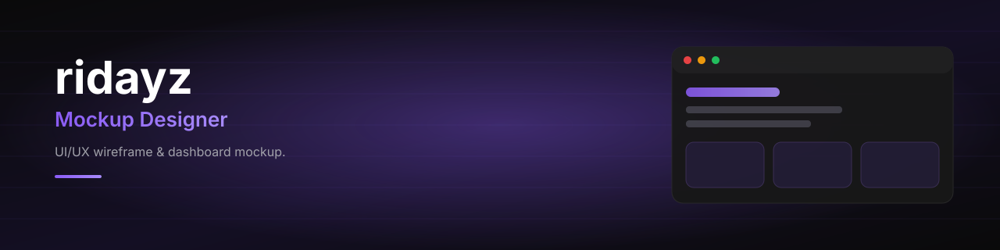



 

  
  
  

### Halo, saya **ridayz** :wave:

**Pembuat mockup** -- saya merancang wireframe, UI dashboard, dan prototipe tampilan
supaya ide bisa dilihat dan diuji **sebelum** ditulis kodenya.

> Desain yang bagus itu yang bikin orang langsung paham cara pakainya.

---

## Yang saya kerjakan

| | |
|---|---|
| **Wireframe & Prototype** | Sketsa struktur halaman sampai jadi tampilan yang bisa diklik dan diuji. |
| **UI Dashboard** | Layout admin & analytics: sidebar, stat card, tabel, chart. |
| **Design System** | Palet warna, tipografi, dan komponen yang konsisten. |
| **Handoff ke Code** | Mockup saya siap diterjemahkan jadi HTML/CSS/JS. |

---

## Karya & Proyek

- **[reouter](https://github.com/ridayz/reouter)** -- gateway AI lokal: auto pilih model terbaik, failover, load balancing, endpoint OpenAI-compatible. Dashboard gelap dengan desain UI rancangan sendiri.

---

## Tools & Skill

---

## Statistik

---

Terima kasih sudah mampir :sparkles:

